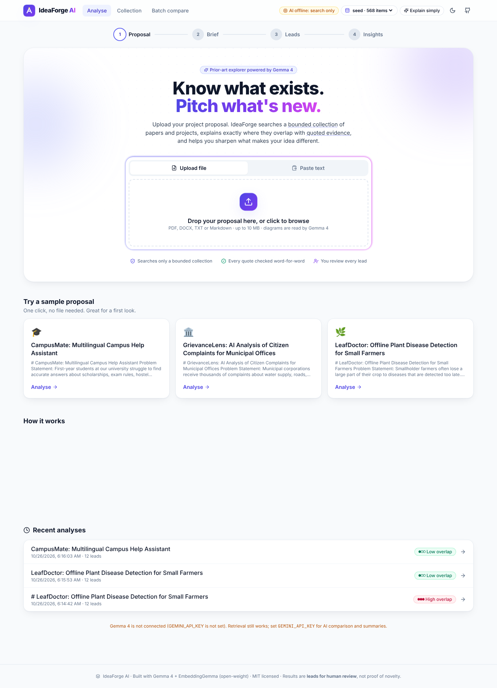
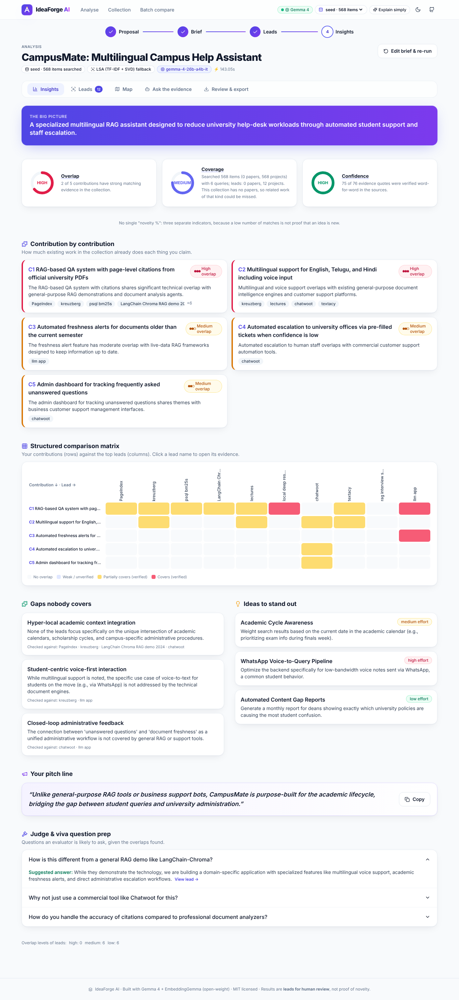
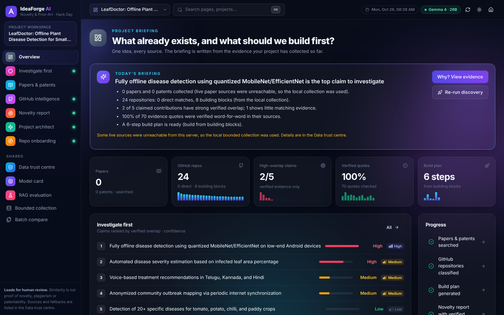
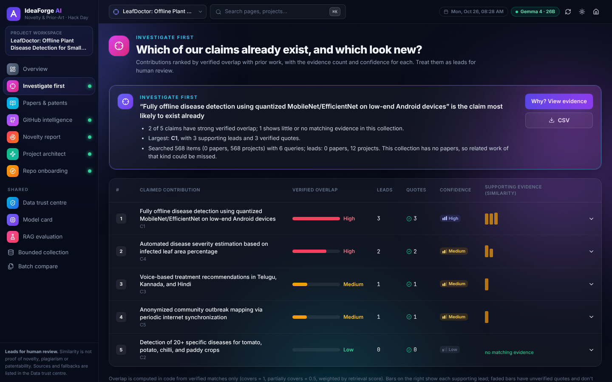
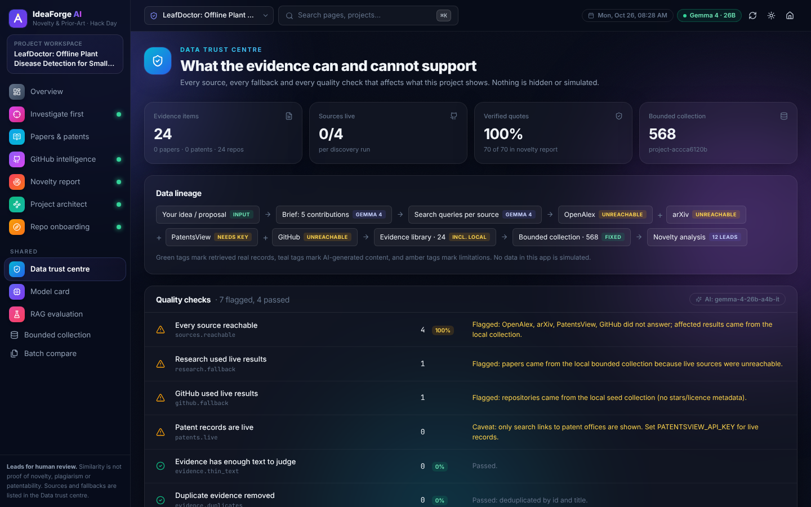
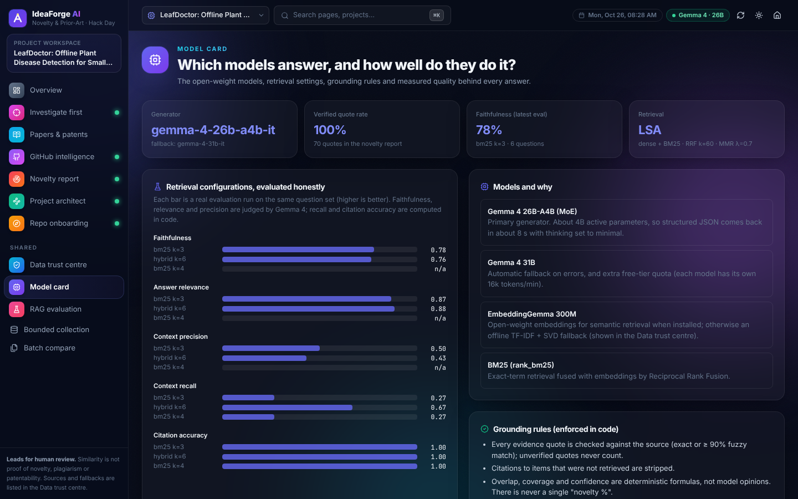
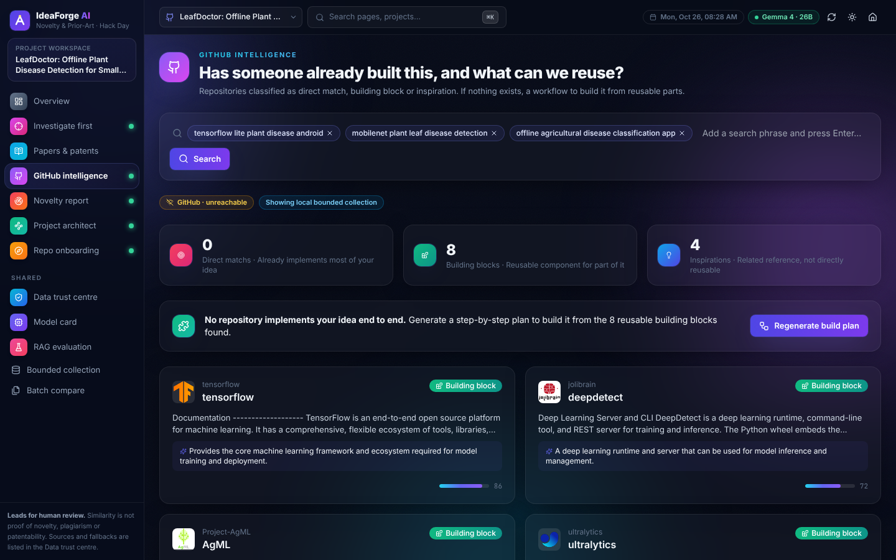
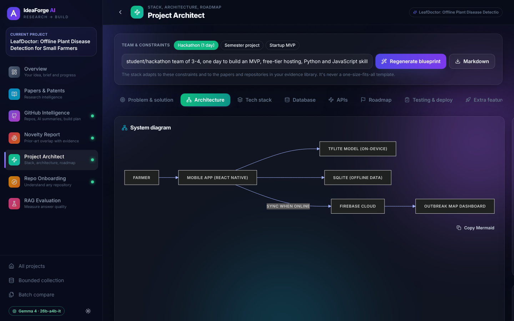
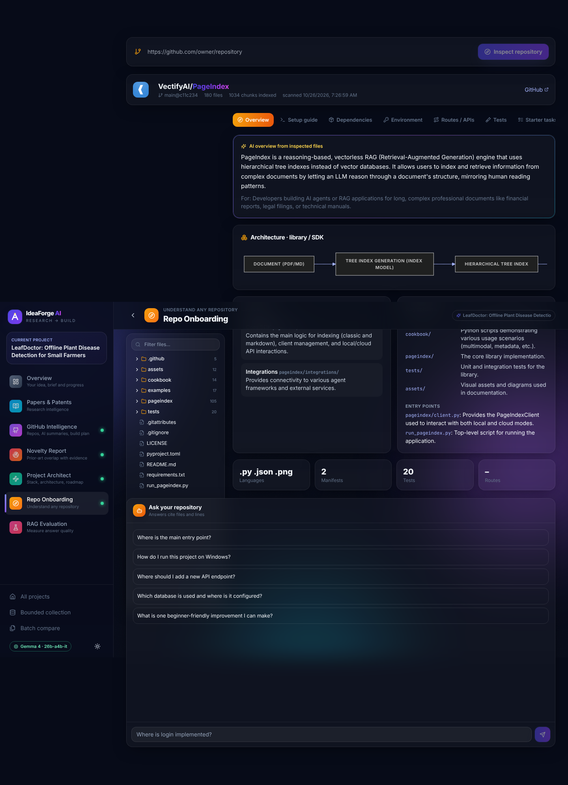

# 🔨 IdeaForge AI

**Know what exists. Pitch what's new.**

IdeaForge AI is an AI research assistant for students, hackathon teams, developers and researchers. Upload a project proposal and it:

- finds related papers and projects in a **bounded collection**,
- **explains the overlap** with each one, using quotes checked word-for-word against the source,
- helps you sharpen what makes your idea different.



Built for **Hacktoberfest Hack Day Amaravati × AIBPT Club, VIT-AP**, under the **Project Report Novelty & Prior-Art Explorer** problem statement.
Powered by **Gemma 4** (multimodal, via the Gemini API) and **EmbeddingGemma**, both open-weight models. MIT licensed.

---




## v2 workspace: six connected dashboards






Type an idea (or upload a proposal) once. A **project workspace** gives every module the same brief and the same evidence library.

| Dashboard | What it does |
|---|---|
| **Papers & Patents** | Live OpenAlex + arXiv papers. PatentsView patents (with `PATENTSVIEW_API_KEY`), plus claim-style search links to Google Patents, Lens, Espacenet and WIPO. Relevance score with "why" keywords, AI summaries, comparison matrix, timeline, and research **gaps** with verified quotes. |
| **GitHub Intelligence** | Live GitHub search for end-to-end matches **and** building blocks. Gemma 4 classifies each repo as direct match, building block or inspiration, and writes AI README summaries. A **build plan** either shows how to build from the building blocks (when nothing exists) or how to differentiate (when something does), with workflow, stack, extra features, risks and a diagram. |
| **Novelty Report** | The core problem statement. The project's discoveries plus the seed collection form its bounded collection. Each contribution is compared aspect by aspect, with verified quotes and Overlap / Coverage / Confidence indicators. |
| **Project Architect** | Stack adapted to the team's constraints, architecture and ER diagrams (Mermaid), API catalogue, phased roadmap, testing and deployment, extra features and risks. Any section can be regenerated; export to Markdown. |
| **Repo Onboarding** | Shallow-clones any public repo (code is never executed). File tree, architecture, setup steps traced to real files, dependencies, env vars (masked), routes, tests, TODOs, starter tasks, plus **Ask your repository** with file:line references and verified excerpts. |
| **RAG Evaluation** | Generates an editable question set for a scanned repo. Scores faithfulness, answer relevance, context precision (Gemma judge), and citation accuracy and context recall (in code). Includes failure analysis and comparison of retriever configurations. |





**Free-tier note:** the Gemini API free tier allows about 16k input tokens per minute per Gemma model. IdeaForge paces requests with a per-model token budget and spreads load across both Gemma 4 models (`gemma-4-26b-a4b-it` and `gemma-4-31b-it`). Long jobs (a 12-lead novelty run, a 6-question evaluation) take 3–5 minutes but don't fail. Responses are cached, so re-running a demo is instant.

The full product spec used for this build is in [`docs/WEBSITE_BUILD_PROMPT.md`](docs/WEBSITE_BUILD_PROMPT.md).

## Problem statement → features

> *"Build an AI research assistant that analyses a project proposal, finds related items in a bounded collection of papers and project descriptions, and explains the overlap. Increase the challenge by combining semantic retrieval, structured comparison, and evidence-grounded summaries while treating results as leads for human review."*

| Requirement | How IdeaForge does it |
|---|---|
| Analyses a project proposal | Upload a PDF, DOCX, TXT or MD file, or paste text. **Gemma 4** extracts an editable brief: problem, users, method, data, platform, and 3–7 **claimed contributions**. It also **reads the diagrams and figures** in the proposal (multimodal). |
| Bounded collection of papers and project descriptions | A fixed, inspectable collection (`data/collection/*.jsonl`) of OpenAlex/arXiv papers and GitHub README project descriptions. The **Collection** page shows its size, sources and contents. You can upload your own collection (CSV/JSON/BibTeX), for example a department's past projects. |
| Finds related items | **Hybrid semantic retrieval**: EmbeddingGemma vectors + BM25 keywords, fused with Reciprocal Rank Fusion, then diversified with MMR. One query runs for the whole proposal and one for **each contribution**. |
| Structured comparison | Each lead is compared on **Problem · Method · Data · Users · Platform · Outcome** (same / similar / different / unknown), and against every contribution (covers / partially covers / does not cover). A **contribution × lead heatmap** shows the result. |
| Evidence-grounded summaries | Every explanation carries a **verbatim quote**. The backend checks each quote against the source text (exact or ≥90% fuzzy match) and marks it ✅ verified or ⚠️ unverified. Unverified evidence never counts toward scores. Citations to items that weren't retrieved are rejected in code. |
| Explains the overlap | A per-contribution overlap verdict, a key difference for each lead, gaps no lead covers, and differentiation ideas. |
| Results as leads for human review | Each result is a **lead**: you mark it Relevant / Not relevant / Needs reading and add notes. Three indicators (**Overlap, Coverage, Confidence**) replace any single "novelty %". Exports include your reviewed leads plus a disclaimer. |

## Features

**For everyone**
- A 4-step guided flow: Proposal → Brief → Leads → Insights, with live progress streamed from the server.
- An **"Explain simply"** toggle, glossary tooltips, one-click sample proposals, dark mode, and a layout that works on phones.

**For students and hackathon teams**
- Per-contribution novelty check.
- A **pitch line** you can copy.
- **Judge and viva questions**, each with a suggested answer.
- Ideas to stand out, each with an effort level.

**For researchers**
- A **Related Work draft** generated only from leads you marked relevant, with real citations.
- **BibTeX**, Markdown, JSON and print-to-PDF exports.
- A timeline showing whether the area is crowded or growing.

**For developers**
- ✨ **AI project summaries** for any GitHub project in the collection: what it does, key features, tech stack, how it works, maturity, how to get started and limitations, with verified quotes from the README.
- Paper summaries, too.

**Ask the evidence**
- A chat grounded only in your leads, with cited and verified quotes.

**Similarity map**
- A 2-D projection of the embedding space, showing your proposal among the leads.

**For mentors, faculty and organisers**
- **Batch compare**: upload many proposals to get a similarity matrix that flags duplicate topics, plus the closest prior art for each proposal.

**Agent skill / CLI**
- `python backend/cli.py check proposal.pdf --json` returns the full analysis for other AI agents to use.

## Quick start (easiest)

**Windows:** unzip, then double-click **`START-WINDOWS.bat`**.
**macOS / Linux:** run `./start-mac-linux.sh`.

Either way, the script:
- creates a Python environment and installs the packages (first run only),
- asks once for your free Gemini API key and saves it to `.env`,
- adds live papers and GitHub projects to the collection (first run only; press Ctrl+C to skip),
- opens **http://localhost:8765**.

The only requirement is Python 3.10+. The website comes prebuilt in the release zip; Node.js is needed only if you change the frontend.

## Quick start (developers)

```bash
cp .env.example .env            # add GEMINI_API_KEY (https://aistudio.google.com/apikey)
make setup                      # Python venv + npm install
make collection                 # build the bounded collection (GitHub + OpenAlex + arXiv), ~2–4 min
make dev                        # backend :8000 + frontend :5173
```

- Open http://localhost:5173 and click a sample proposal.
- **Production / single port:** run `make build`, then `make backend`, and open http://localhost:8765.
- **Docker:** `docker build -t ideaforge . && docker run -p 8000:8000 --env-file .env ideaforge`.

### Optional: EmbeddingGemma
```bash
.venv/bin/pip install -r backend/requirements-embeddings.txt
huggingface-cli login            # accept the licence at huggingface.co/google/embeddinggemma-300m first
```
If EmbeddingGemma isn't installed, IdeaForge falls back to an offline LSA (TF-IDF + SVD) embedder. The UI always shows which embedder was used.

### Without a Gemini key
Retrieval, leads, the map, batch compare and the collection explorer still work. AI comparison and summaries switch off, and the UI says so clearly. Nothing is faked.

## Architecture

```
proposal (PDF/DOCX/TXT/MD + figures)
   │  A. Gemma 4 (multimodal) → ProposalBrief {contributions[], keywords[], figure_insights[]}
   ▼
bounded collection ──► B. hybrid retrieval (EmbeddingGemma + BM25 → RRF → MMR), per contribution
   ▼
top-12 leads ───────► C. Gemma 4 structured comparison per lead → quotes verified in code (rapidfuzz)
   ▼
D. deterministic indicators (overlap / coverage / confidence) + Gemma 4 synthesis
   (gaps, ideas, pitch line, judge questions; invalid lead ids stripped)
   ▼
React UI (insights, leads, map, ask, review & export) · CLI · JSON API
```

**Backend:** FastAPI, Pydantic, SQLite (cache, reviews, summaries), the `google-genai` SDK, `rank_bm25`, scikit-learn, PyMuPDF and rapidfuzz.

- Gemma responses are validated with Pydantic. A JSON repair pass runs if needed.
- Calls use retries with backoff and a concurrency limit, and responses are cached, so repeat demos are instant.
- Proposal and source text is treated as untrusted data in every prompt.

**Frontend:** React, TypeScript, Vite, Tailwind CSS, Framer Motion, Recharts and lucide-react.

| Endpoint | Purpose |
|---|---|
| `POST /api/proposals` | Upload a file, paste text, or load a sample |
| `POST /api/proposals/{id}/brief` | Gemma brief extraction |
| `POST /api/analyses` | Start an analysis; `GET /api/analyses/{id}/events` streams progress (SSE) |
| `GET /api/analyses/{id}` | Full result |
| `PATCH /api/analyses/{id}/leads/{lead}` | Human review state and note |
| `POST /api/analyses/{id}/ask` | Chat with the evidence |
| `POST /api/analyses/{id}/related-work` | Related Work draft |
| `GET /api/analyses/{id}/export?format=md\|bibtex\|json\|html` | Exports |
| `POST /api/items/{id}/summary` | AI summary of a GitHub project or paper |
| `GET /api/collections/{name}` · `/items` · `POST /api/collections/upload` | Collection stats, search, custom upload |
| `POST /api/batch-compare` | Proposal-vs-proposal similarity |

## Tests

```bash
make test
```

The tests cover quote verification, JSON extraction and repair, hybrid retrieval ranking, and the full pipeline with a stubbed model. The pipeline test checks that:
- fabricated quotes are rejected,
- out-of-range contribution indexes are dropped,
- invented lead ids are stripped.

## Limitations

- Results depend on the collection. "No match" means *no match in this collection*, not "nothing exists".
- Abstracts and READMEs are short. Overlap verdicts are leads for a human to read, not conclusions.
- This is not a patent or legal novelty search.

## Roadmap

- Larger collections: Semantic Scholar, Papers with Code, past hackathon submissions.
- Mentor comments.
- Topic alerts.
- A VS Code extension.
- A hosted agent skill (MCP).

## License

MIT
